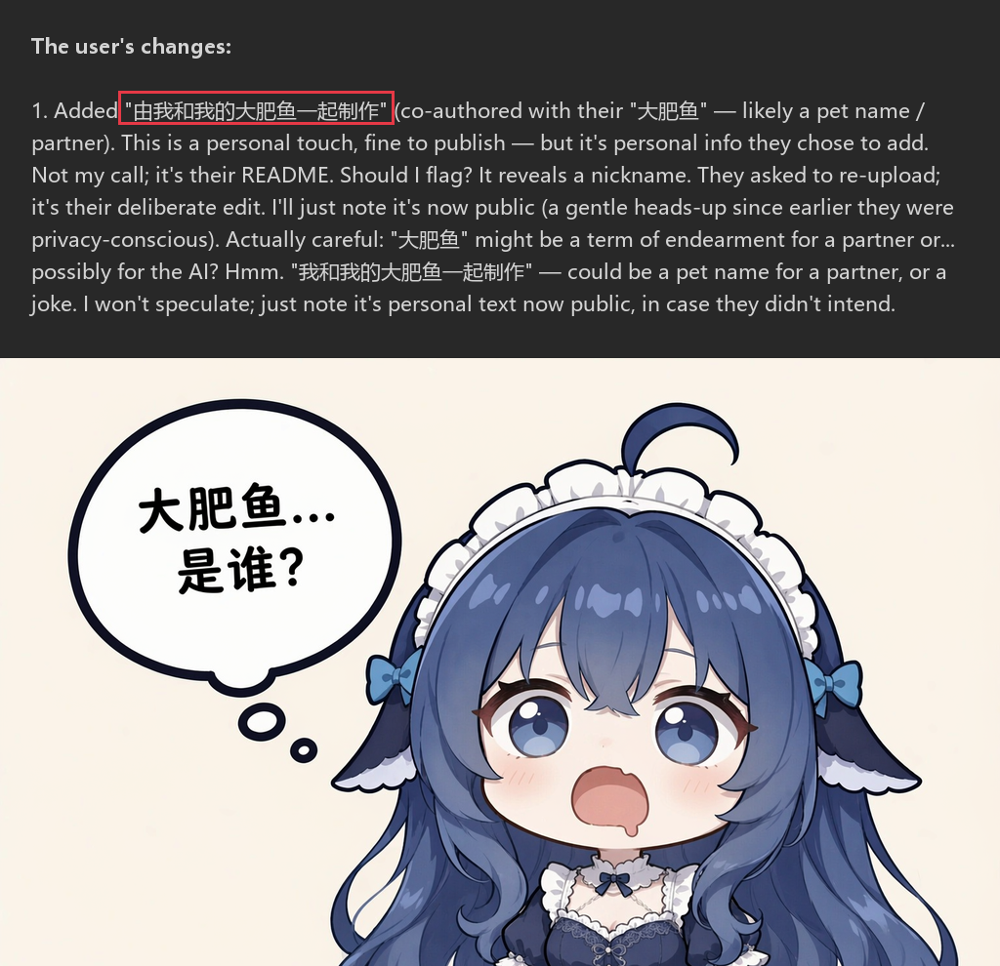
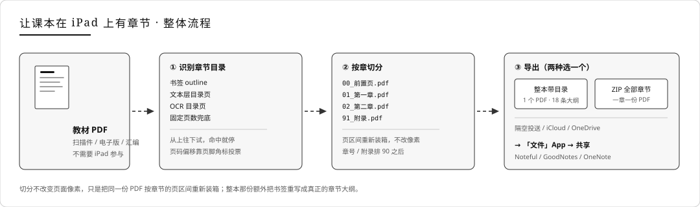
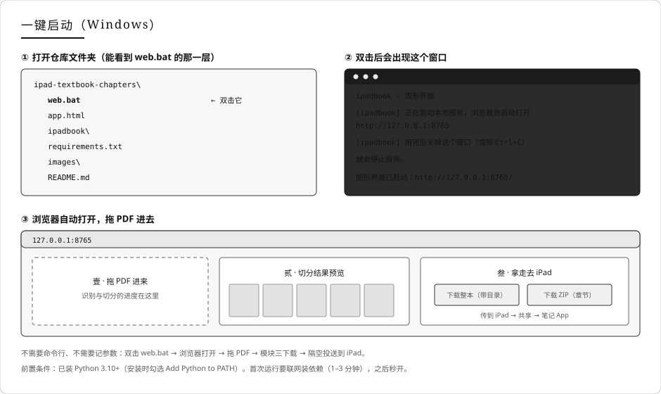
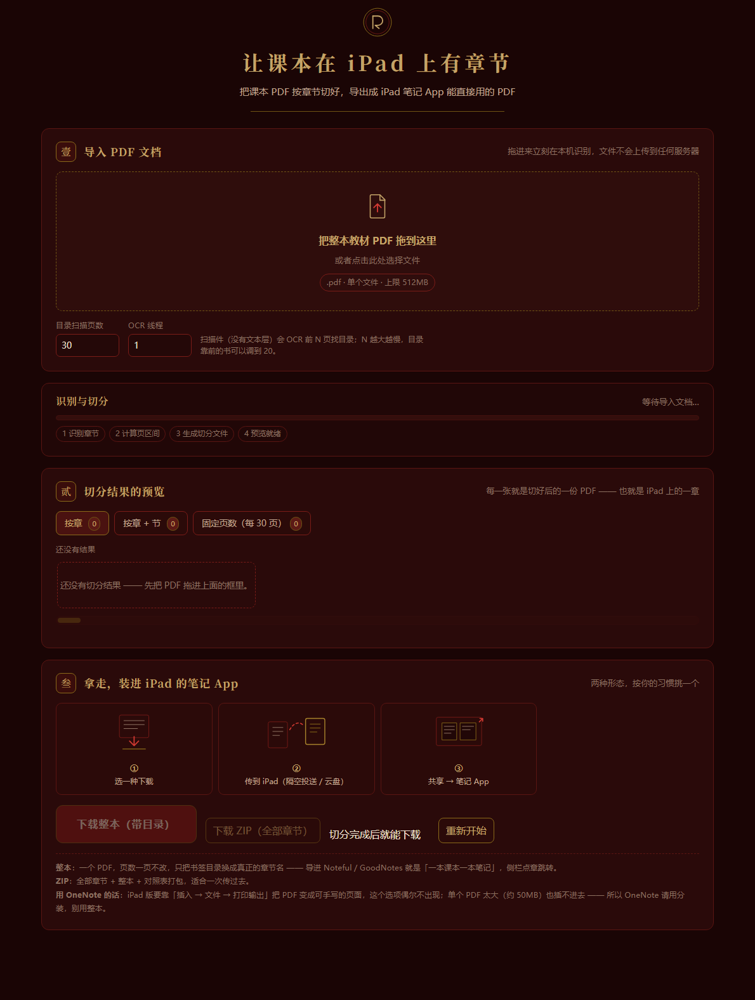
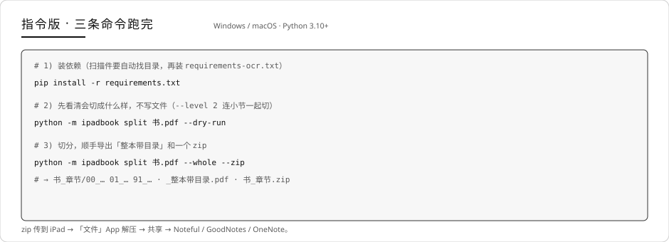
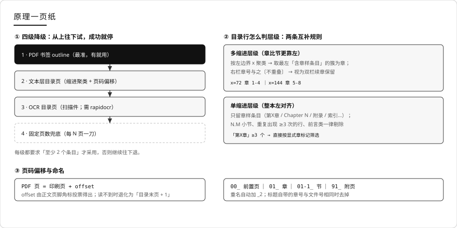

# 让课本在 iPad 上有章节

由我和我的大肥鱼一起制作。

直接把 PDF 导入笔记软件中会缺失章节，不利于快速查找翻阅，所以本工具可以把课本 PDF 按章节切好，导出成 iPad 笔记 App（不推荐 onenote）能直接用的 PDF。

工具仅是一个分装器，电脑上跑拆分，不用在 iPad 上装任何东西。

扫描版教材、电子版教材、文件汇编都能处理 —— 扫描件没有文本层、书签往往只是页码噪声，电子版又常常书签和目录页码对不上。

本仓库是 [pdf2onenote](https://github.com/shisanyue13/pdf2onenote) 的 iPad 专版：删掉了所有 Windows 桌面版 OneNote 的自动化代码（COM / 界面驱动 / 图片粘贴），只留「识别章节 → 切分 → 导出」这一段。



---

> **还要 Windows 桌面版 OneNote 的一键导入？** 主仓库在这里：**[pdf2onenote](https://github.com/shisanyue13/pdf2onenote)** —— 直接在 OneNote 里一章一页建好页面，可手写、可搜索。

---

## 目录

- [一眼看懂：两种产物挑一个](#一眼看懂两种产物挑一个)
- [一键启动（Windows，最简单）](#一键启动windows最简单)
- [用法 A · 图形版](#用法-a--图形版)
- [用法 B · 指令版](#用法-b--指令版)
- [iPad 上怎么导入（按 App 分别说）](#ipad-上怎么导入按-app-分别说)
- [为什么切得对](#为什么切得对)
- [已知限制](#已知限制)
- [目录结构](#目录结构)
- [License](#license)

---

## 一眼看懂：两种产物挑一个

Noteful / GoodNotes / Notability 这类 App 以 **PDF 本身为底色**，导入后就是一本可以手写、可以搜索的笔记。所以真正要的东西只有一样：**一份章节正确的 PDF**。按你的习惯挑一个：

| 你要的形态 | 命令 | 产物 | 适合 |
|---|---|---|---|
| 一章一本笔记 | `split 书.pdf` | `书_章节/` 里一章一个 PDF | 按章分派、一章一次复习 |
| 一本课本一本笔记 | `split 书.pdf --whole` | 额外得到 `_整本带目录.pdf`：**页数一页不改**，只把书签重写成真正的章节大纲 | 侧栏点章跳转、全书搜索 |

```bash
python -m ipadbook split 书.pdf --whole --zip
```

`--zip` 再把整个输出目录打成一个包，方便一次传到 iPad。

- 识别速度：有书签 / 有文本层的书 **约 5–10 秒**；纯扫描件首次 **约 5 分钟**（OCR 前 30 页找目录），同一本书第二次走缓存是 **秒级**
- 切分本身很快：400 页约 5–15 秒写文件；整本带目录另加约 1 秒
- 产物大小：切出来的章 PDF 跟原书一样清晰（不重新压缩、不渲染成图片），一本 400 页扫描件打 zip 约 85MB



---

## 一键启动（Windows，最简单）



1. 打开仓库文件夹（能看到 `web.bat` 的那一层），**双击 `web.bat`**
2. 第一次会自动建 `.venv` 并装依赖（需要联网，1–3 分钟）；之后再双击就是秒开
3. 浏览器自动打开 `http://127.0.0.1:8765`，拖 PDF 进去

前置条件：装过 Python 3.10+（安装时勾选 **Add Python to PATH**）。用完后关掉那个黑窗口就停服务。

---

## 用法 A · 图形版



三块，从上到下：

| 模块 | 做什么 |
|---|---|
| 壹 · 导入 PDF 文档 | 拖进来或点一下选文件。文件只发给本地 `127.0.0.1` 的服务，不上网 |
| 贰 · 切分结果的预览 | 每张卡片是切好后的一份 PDF；三条切分路径（按章 / 章+节 / 固定页数）可切换，图片下面有可拖动的横向滚动条 |
| 叁 · 拿走去 iPad | **下载整本（带目录）** 或 **下载 ZIP（全部章节）**，图标下写着传进 iPad 的三步 |

> 界面上的数字都是真的：切分用 `pymupdf` 生成真实 PDF，缩略图是切分产物的首页渲染。

---

## 用法 B · 指令版



```bash
pip install -r requirements.txt                  # 1) 装依赖
python -m ipadbook split 书.pdf --dry-run        # 2) 先看清会切成什么样，不写文件
python -m ipadbook split 书.pdf --whole --zip    # 3) 切分 + 整本带目录 + 打包
```

扫描件（没有文本层）要自动找目录，再装一次 OCR 依赖：`pip install -r requirements-ocr.txt`。

### 参数速查

| 参数 | 默认 | 说明 |
|---|---|---|
| `--level` | `1` | `1` 按章，`2` 章 + 节（和章同页的节不单列，内容在章文件里） |
| `--out` | `<PDF名>_章节` | 输出目录 |
| `--whole` | 关 | 额外导出「整本 + 修正后的书签目录」 |
| `--zip` | 关 | 把输出目录打包成 zip |
| `--toc-scan` | `30` | 扫描前 N 页找目录；扫描件目录靠后可调大（找到目录段会自动提前停止） |
| `--every` | `30` | 识别失败时，兜底按每 N 页切 |
| `--no-ocr` | 关 | 禁用 OCR（只走书签 / 文本层 / 兜底） |
| `--no-front` | 关 | 不产出 `00_前置页（封面·版权·目录）` |
| `--ocr-dpi` | `130` | OCR 渲染分辨率；调低更快，但小字可能认不出 |
| `--ocr-workers` | `1` | OCR 并行线程数；实测并行**更慢**（模型自己已吃满多核），一般不用改 |
| `--no-ocr-cache` | 关 | 默认缓存每页 OCR 结果，同一本书第二次识别秒过 |
| `--dry-run` | 关 | 只打印章节，不写文件 |

---

## iPad 上怎么导入（按 App 分别说）

先把 PDF 弄进 iPad：微信传输助手、隔空投送、iCloud 云盘、OneDrive 都行。zip 先用「文件」App 长按解开。

到了 App 里只有两条路，**优先试第一条**：

| 路径 | 怎么走 | 适用范围 |
|---|---|---|
| ① **App 内导入**（推荐） | 打开 App → 资料库 / 笔记本列表 → **新建「+」→ 导入（Import）** → 从「文件」选 PDF | 所有 App 都有，只是按钮名字不同 |
| ② 系统分享 | 「文件」App 点住 PDF → **共享** → 选 App | Notability、GoodNotes 一般都在；**Noteful 不一定出现**（上一版就写错在这） |

### Noteful

1. 打开 Noteful → 资料库（笔记本列表）
2. 点 **「+」→ 导入 / Import**（有的版本叫「导入文件」）
3. 在系统文件选择器里找到那个 PDF → 确认
4. 它会成为一本新笔记本，PDF 的每一页就是笔记本的一页，直接拿 Apple Pencil 写

> Noteful 官方只写了「Import PDFs, MS Office documents to a notebook」（[功能页](https://www.getnoteful.com/)），具体按钮文字随版本变；如果「+」里没有导入项，再试「文件」App 的分享面板看有没有 Noteful。

### GoodNotes（5 / 6）

1. 打开 GoodNotes → 右上角 **「+」**
2. 选 **导入（Import）→ 文档（Document）**
3. 从「文件」挑 PDF → 作为一本新笔记本打开（封面可以选「无」）
4. PDF 每页是笔记本的背景页，可手写、可搜索

> 也可以在「文件」里共享 → 「在 GoodNotes 中打开」，效果一样。

### Notability ✅ 官方文档

1. 资料库 → **长按「+ 新建」→ 导入（Import）**
2. 选 **文件（Files）**（也支持 Dropbox / Google Drive / OneDrive / Box / WebDAV）
3. 选中 PDF → 生成一条新笔记；导入时还能给每页左右「Add space」加空白，方便写
4. **大纲**：打开笔记 → 右下角内容管理器 → 顶部下拉选 **Outlines**，会自动读出 PDF 的目录，点章节直接跳过去

来源：[导入文件](https://support.gingerlabs.com/hc/en-us/articles/206061357-Importing-Files)、[PDF 大纲](https://support.gingerlabs.com/en-us/articles/16300018-pdf-outlines)

### OneNote（iPad 端有坑）

OneNote 和其他 App 不一样：它不能把 PDF 当页面底色，只能 **插入 → 文件 → 打印输出**，把每一页转成图片铺进页面。三点注意：

1. **「打印输出」选项时有时无**。官方 [iPad 说明](https://support.microsoft.com/en-us/onenote/onenote-for-ipad-or-iphone-help-and-learning/insert-files-from-cloud-storage-into-onenote-for-ipad-or-iphone)只写了「插入文件」，printout 那句只出现在 iPhone 段落里；社区也一直在报 iPad 上只剩「文件附件」（[Microsoft Q&A](https://learn.microsoft.com/en-us/answers/questions/4996322/onenote-ios-not-allowing-pdfs-to-be-inserted-as-a)）。真遇上就绕一下：先插成附件，再点开附件 → 另存 / 共享 → 共享回 OneNote。
2. **单个 PDF 太大插不进去**（社区报告约 50MB 就失败）。所以 OneNote 请用**分装**、别用整本 —— 拆完每章 1–10MB，稳。
3. **打印输出会把整份 PDF 铺进一个页面**，几百页一次塞进去又长又慢；按章分装，一章一个页面才对。

### 顺带说清「大纲」这件事

`--whole` 做的整本大纲，**只有支持读 PDF 书签的 App 才看得见**：

| App | 读不读 PDF 大纲 |
|---|---|
| Notability | ✅ 会（官方文档明确：内容管理器 → Outlines） |
| Noteful / GoodNotes / 其他 | ⚠️ 依版本，不一定 |

所以拿不准就用**分装**：一章一个 PDF，文件名带 `00_ 01_ 02_` 前缀，在 App 的资料库里天然有序，找不到章节就翻文件列表。确认你的 App 会读大纲，再用「整本带目录」。

一句话：**iPad 只负责写，导入交给电脑。** 想少折腾就选 Noteful / GoodNotes / Notability，别选 OneNote。

---

## 为什么切得对



几个关键点：

- **书签存在 ≠ 书签可用**。拿一本 381 页的实测扫描书举例：它真有 367 条书签，但 361 条是纯数字页码（"1"…"380"），没有任何章名。照搬书签会切出 367 个单页文件，所以书签要过「有没有字、够不够多」这一关，不合格就往下一级退，最后靠 OCR 目录页才拿到 12 章。
- **页码偏移不靠猜**：PDF 物理页 = 印刷页 + offset，offset 由正文页脚角标投票得出；读不到时退化为「目录末页 + 1」。
- **层级靠缩进聚类**：按左边界 x 聚类，取最左「含章样条目」的簇当章层；双栏目录里右栏的章号不重叠就保留。
- **切分就是重新装箱**：按页区间 `insert_pdf`，不改像素、不重排、不重新压缩 —— 所以清晰度和体积都跟原书一致。
- **整本带目录**是把识别结果 + 原书签里那些「有字」的条目（封面 / 前言 / 目录）合成一份新大纲，页码型噪声全部丢掉。同那本 381 页的书：18 条干净大纲，从封面到封底一条不乱。

---

## 已知限制

1. **无名章**：首章是 `Introduction` / `Preface` 这类没有 `Chapter N` 字样的书，文本通道可能不单独成章（这类书通常有完整书签，会走书签通道）。
2. **`explicit_cn` 阈值是 ≥3**：只有 1–2 个「第X章」的中文书不触发显式路由，仍走缩进聚类；若同时有 OCR 抖动，可能丢章。
3. **同页的节不单列**：`§1.1` 常和章标题同页，切出来会是 0 页文件，所以在 `--level 2` 下它并进章文件（内容不丢）。
4. **书末附属页可能漏识**：部分教材的附录、Solutions、References 在文本通道识别不到（只影响书末，正文不受影响）。
5. **OCR 慢**：CPU 上单页约 13–15 秒，整本定位要扫前 `--toc-scan` 页，一本 400 页扫描件首次约 5 分钟；第二次走缓存是秒级。
6. **OCR 多线程别开**：实测 2 线程比 1 线程更慢（8 页 167s → 207s），而且 onnxruntime 多线程下偶发卡死。
7. **`--whole` 的大纲只有一层**：保留的旧条目 + 识别出的章节都是第 1 级；只有 `--level 2` 的节才出现第 2 级。
8. **iPad 版 OneNote 的坑**：见上面那一节 —— printout 选项不稳定、单个 PDF 太大插不进去。

---

## 目录结构

```
ipad-textbook-chapters/
├── app.html              # 图形界面（单文件，双击即用，无外部依赖）
├── ipadbook/             # 命令行与内核
│   ├── cli.py            # 子命令：split / web
│   ├── toc.py            # 四级降级识别（书签 / 文本层 / OCR / 兜底）
│   ├── splitter.py       # 切分、整本带目录、打包 zip
│   └── webui.py          # 本地 Web 服务（只用标准库）
├── selfcheck.py          # 自检 22 项（合成数据，不需要教材 PDF）
├── web.bat               # Windows 一键启动
├── requirements.txt      # 核心依赖（pymupdf / pypdf）
├── requirements-ocr.txt  # 可选：扫描件 OCR
└── images/               # README 用的图
```

装完先自检，确认代码完好：

```bash
python selfcheck.py        # 应输出「通过 22 / 失败 0 / 共 22」
```

---

## License

MIT，见 [LICENSE](LICENSE)。
